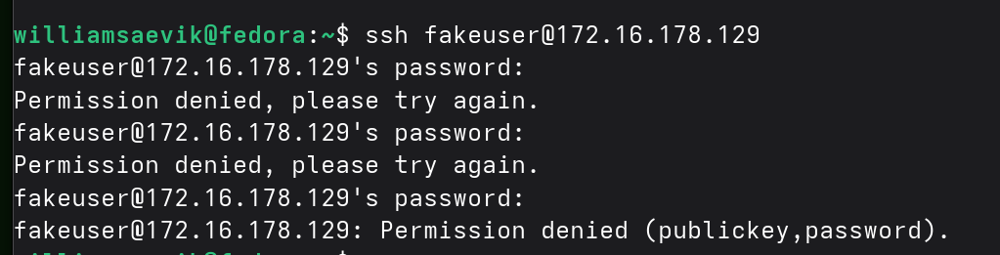
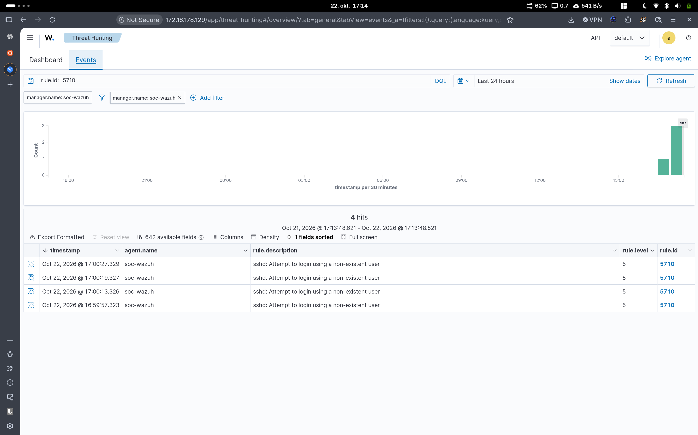
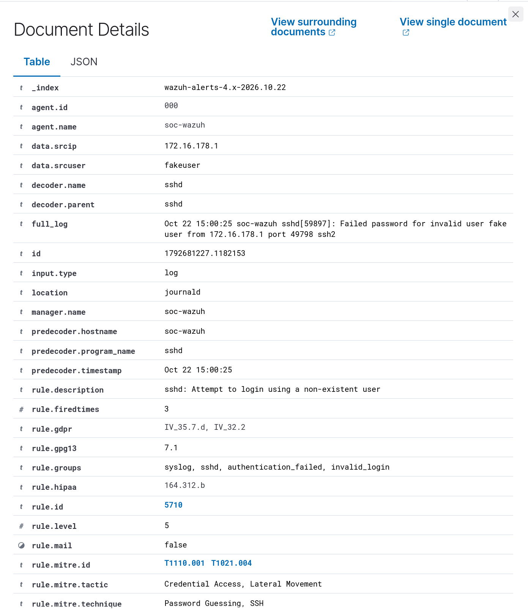

# SOC-001 – Detecting Failed SSH Login Attempts

## Overview

For my first SOC lab exercise, I wanted to see how Wazuh detects failed SSH login attempts on a Linux server.

I used Fedora as my main operating system and Ubuntu Server running in VMware. Wazuh was installed on the Ubuntu server to collect and analyze security logs.

The goal was to generate some failed login attempts, investigate the logs, and see whether Wazuh could detect the activity.

## Lab Setup

For this exercise, I used:

- **Fedora Linux 44** – My main operating system
- **VMware Workstation** – To run the virtual machine
- **Ubuntu Server 24.04 LTS** – The monitored Linux server
- **Wazuh SIEM 4.14.9** – To detect and analyze security events
- **OpenSSH** – To generate authentication events

Everything was running locally on my own computer.

## Testing the Detection

To simulate suspicious login activity, I opened a terminal on Fedora and tried connecting to my Ubuntu server using a username that didn't exist.

```bash
ssh fakeuser@172.16.178.129
```

I intentionally entered incorrect passwords several times.

After the attempts, I connected to Ubuntu and checked the SSH logs using:

```bash
sudo journalctl -u ssh --since "5 minutes ago" --no-pager
```

The logs showed that the server had registered the invalid username and failed password attempts.

## Investigating the Alerts in Wazuh

Next, I opened the Wazuh dashboard and went to **Threat Hunting**.

I searched for rule ID `5710`, which detects attempts to log in using a non-existent user.

Wazuh returned four alerts related to the test.

Some of the information I found:

| Field | Result |
|---|---|
| Source IP | 172.16.178.1 |
| Username | fakeuser |
| Server | soc-wazuh |
| Wazuh Rule ID | 5710 |
| Rule Level | 5 |
| Description | Attempt to login using a non-existent user |

I also found related alerts for failed PAM authentication and repeated incorrect passwords.

This confirmed that Wazuh was successfully collecting and analyzing the authentication logs.

## MITRE ATT&CK

Wazuh mapped the activity to two MITRE ATT&CK techniques:

- **T1110.001 – Password Guessing**
- **T1021.004 – SSH**

These mappings helped me understand how SSH authentication failures can relate to techniques used by attackers.

However, this was only a controlled simulation, and there was no evidence of a successful login or actual compromise.

## What I Learned

This exercise helped me understand how Linux authentication logs are collected and analyzed by a SIEM.

I also got some practical experience with:

- Using `journalctl` to investigate Linux logs
- Finding security events in Wazuh Threat Hunting
- Understanding Wazuh detection rules and severity levels
- Identifying source IP addresses and failed login attempts
- Connecting security events to MITRE ATT&CK

One thing I found interesting was how Wazuh could detect different parts of the same login attempt using multiple rules.

## Possible Improvements

If I were securing a production Linux server, I would consider using SSH keys instead of password authentication, restricting SSH access to trusted networks, and monitoring repeated failed login attempts.

For future exercises, I would also like to experiment with custom Wazuh detection rules.

## Conclusion

My first SOC lab test was successful. I was able to generate failed SSH login attempts, locate them in the Linux logs, and confirm that Wazuh detected the activity.

This gave me a better understanding of how a SOC analyst can investigate authentication-related security events using a SIEM.

## Screenshots

### Failed SSH Login Attempts


### Wazuh Threat Hunting


### Wazuh Detection Details

